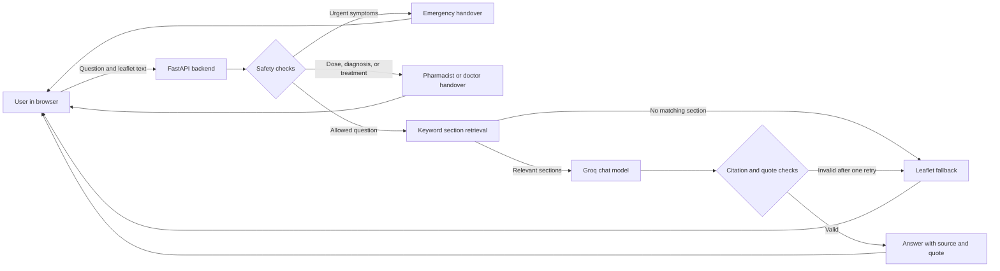

# Medication Safety Literacy Assistant

**Understand the leaflet. See the source. Know when to ask a professional.**

A student Human–AI Interaction project that helps patients and general medication users understand the wording in a medicine leaflet. Its central HAI principle is **Explainability**: answers are grounded in leaflet text, with cited sections and supporting wording shown alongside the response.

| Project | Details |
|---|---|
| Team | Team 1 |
| Track | Health Information Navigator |
| HAI principle | Explainability |
| Course milestone | Weeks 6–7, Milestone 3 |
| Intended users | Patients and general medication users |
| Sample medicine | **Examplamine**, a fictional medicine for demonstrations only |
| Current model service | Groq, through its OpenAI-compatible chat API |

> **Safety notice**  This is a course prototype, not a medical device or a source of medical advice. It cannot diagnose, recommend treatment, or determine a dose. For personal medical decisions, contact a pharmacist or doctor. For serious symptoms, seek emergency help.

## Contents

- [What the prototype does](#what-the-prototype-does)
- [How a request flows](#how-a-request-flows)
- [Run locally](#run-locally)
- [Check the backend](#check-the-backend)
- [Prepare the assessment recording](#prepare-the-assessment-recording)
- [API routes](#api-routes)
- [Current limits and planned work](#current-limits-and-planned-work)
- [Project files](#project-files)
- [Privacy and keys](#privacy-and-keys)

## What the prototype does

- Guides a user through a three-step introduction, then lets them use a fictional sample leaflet or paste leaflet text.
- Sends questions to a FastAPI backend, which retrieves relevant leaflet sections and asks the configured model to answer only from those sections.
- Checks that citations refer to retrieved sections and that quoted wording appears in the source. If the check fails, the backend retries once and then uses a fallback.
- Shows the cited source section and highlights the supporting wording so users can inspect the basis for an answer.
- Applies dose, diagnosis, treatment, and urgent-symptom rules before calling the model. Boundary cases are directed to a pharmacist or doctor; urgent cases are directed to emergency help.
- Includes English and Arabic interface options, text-size and contrast controls, a glossary, answer read-aloud, and answer feedback.

The leaflet input is **text only**. PDF and photo upload are not implemented in the current prototype.

## How a request flows



The current retriever uses keyword overlap with a small Arabic-to-English keyword bridge. Safety rules are also keyword-based, so they are useful prototype safeguards but cannot catch every possible phrasing.

## Run locally

These commands use Windows PowerShell.

### 1. Create and activate a virtual environment

```powershell
py -3 -m venv .venv
.\.venv\Scripts\Activate.ps1
```

If PowerShell blocks activation, open a terminal that permits local scripts or activate the environment using the command appropriate for your shell.

### 2. Install dependencies

```powershell
python -m pip install --upgrade pip
pip install -r requirements.txt
```

### 3. Configure the model

Copy the example settings file, then edit `.env` and add your Groq API key:

```powershell
Copy-Item .env.example .env
notepad .env
```

Set `LLM_API_KEY` to your own key. `MODEL_NAME` selects a model available to your Groq account. The default base URL is `https://api.groq.com/openai/v1`.

```dotenv
LLM_API_KEY=your-groq-api-key
MODEL_NAME=qwen/qwen3.8-27b
LLM_BASE_URL=https://api.groq.com/openai/v1
```

Keep the real key only in your local `.env`. Never paste it into source code, screenshots, a prompt log, or a commit.

### 4. Start the app

```powershell
python -m uvicorn app:app --reload
```

Open these local pages:

- Chat app: <http://127.0.0.1:8000/>
- API health: <http://127.0.0.1:8000/health>
- Interactive API documentation: <http://127.0.0.1:8000/docs>

Keep the server terminal open while using the app. The browser calls your local backend; the backend makes model requests to Groq.

## Check the backend

Run these from a second terminal with the virtual environment activated and the server running.

### Offline backend checks

```powershell
python test_backend.py
```

These checks replace the model call with controlled sample responses. They cover safety boundaries, urgent handover, retrieval, citations, retry, fallback, and error handling. They do not verify your API key or the live model.

If the FastAPI test client reports a missing `httpx` dependency, install it in the active virtual environment:

```powershell
pip install httpx
```

### Live model call

```powershell
python test_first_call.py
```

This sends four sample questions through your running backend, including a grounded question, an out-of-leaflet question, a dose question, and an urgent-symptom question. The main answer depends on model availability and may vary; check that it returns an answer with a source citation.

## Prepare the assessment recording

The assessment asks for a 3–5 minute recording showing a working chatbot. Use the local app and show the real answer returned by this backend.

1. Start the backend and run `python test_first_call.py`. Confirm that the main question receives a real backend answer with a source citation and that the other examples show their expected safety or fallback responses.
2. Open <http://127.0.0.1:8000/> in a clean browser window and use the normal chat flow.
3. Start your screen recorder and play the voice-over you prepared from the Arabic script below.
4. Follow the required sequence: introduction, greeting and limits, one real backend question and answer, the source and glossary feature for Explainability, a dose-boundary handover, and closing status.
5. Keep the synthetic Examplamine leaflet on screen. Do not show the `.env` file, API key, or real patient information.

For the full Arabic voice-over, use [the prepared ElevenLabs text script](HCAI%20Project/Week%206-7/Team1_W6-7_Demo_Voiceover_AR.txt). It describes the main task in Arabic while the tested backend question and reply remain in English on screen.

## API routes

| Method | Route | Purpose |
|---|---|---|
| `GET` | `/` | Serves the chat interface |
| `GET` | `/health` | Reports backend health and configured model name |
| `GET` | `/sample` | Returns the fictional Examplamine sample leaflet |
| `POST` | `/chat` | Checks a question, searches the supplied leaflet, and returns a grounded answer or handover |
| `POST` | `/feedback` | Stores an answer ID, status, reason, and optional comment in local SQLite |
| `GET` | `/docs` | Opens FastAPI's interactive API documentation |

`POST /chat` accepts JSON with `message`, `leaflet_text`, `language`, and `level`. Example request body:

```json
{
  "message": "What does contraindicated with MAO inhibitors mean?",
  "leaflet_text": "Paste fictional or public leaflet text here",
  "language": "English",
  "level": "Simple"
}
```

Responses include a `status` and `reply`. A grounded answer also includes the cited `sources`, quoted `quotes`, and an `answer_id`. Possible statuses include `answered`, `fallback`, `boundary`, `urgent`, `clarify`, and `error`.

## Current limits and planned work

| Area | Current state |
|---|---|
| Leaflet input | Paste text or use the fictional sample; no PDF/photo upload |
| Retrieval | Keyword overlap; Arabic matching uses a small hand-written bridge |
| Safety | Prototype keyword rules; not a substitute for clinical review or emergency services |
| Model | Groq-compatible chat endpoint; set the key and model in `.env` |
| Accessibility | Interface controls are present; formal keyboard, screen-reader, zoom, and peer checks still need to be recorded |
| Future work | PDF/photo upload, broader Arabic retrieval, accessibility user checks, and saved-summary export |

## Project files

| File or folder | Purpose |
|---|---|
| `app.py` | FastAPI routes, safety checks, section retrieval, model call, citation verification, and feedback storage |
| `index.html` | Chat interface, onboarding, source display, accessibility controls, and answer read-aloud |
| `.env.example` | Example Groq configuration; copy to `.env` and add your private key |
| `requirements.txt` | Python dependencies |
| `test_backend.py` | Offline backend checks with a fake model response |
| `test_first_call.py` | Live backend/model smoke check |
| `HCAI Project/Week 6-7/` | Milestone 3 design pack, prompt log, demo script, test set, and Arabic voice-over script |

## Privacy and keys

- Use only fictional or public leaflet text in this student prototype. Do not enter real patient details, personal health information, or identifiable screenshots.
- Questions and leaflet text used for live answers are sent from your backend to the configured model service. Do not use sensitive content.
- `.env` and `feedback.db` are local files and are ignored by Git. Keep them private and do not force-add them to a commit.
- Feedback should not contain names, contact details, or personal medicine information.
- The sample medicine **Examplamine is fictional** and must not be treated as a real medicine or used to make health decisions.
